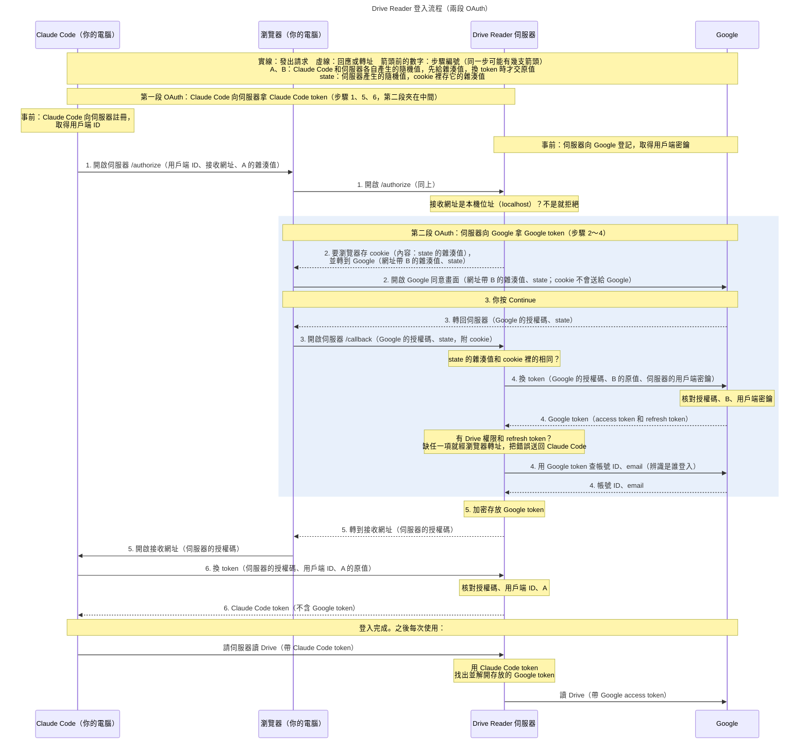

# 登入流程（OAuth）

這份文件說明 Google Drive Reader 的登入怎麼運作。安裝與使用步驟見 [README](../README.md)。

## 為什麼需要 OAuth

Claude Code 要透過作者的伺服器（跑在 Cloudflare Workers 上，下稱「伺服器」）讀你的 Drive，但
伺服器和 Claude Code 都不該拿到你的 Google 密碼。OAuth 是解決這件事的標準協定：你同意授權後，
**授權方**（發 token 的一方）就把 **token** 發給發起這次登入的那支程式。token 是一串別人猜不到的
字串，有權限範圍、會過期、可撤銷；程式之後每次存取資料都帶著它。

這裡有兩支程式要拿 token，所以登入其實是兩段 OAuth：

- **第一段：Claude Code 向伺服器拿 token**（下稱 Claude Code token）。授權方是伺服器。伺服器
  沒有自己的同意畫面；你在 Google 按 **Continue** 之後，伺服器就經由瀏覽器把授權碼（下一節說明）送到這次登入的接收網址（下一節說明），正常情況下由 Claude Code 收下，再用它換 token。
- **第二段：伺服器向 Google 拿 token**（下稱 Google token），夾在第一段中間。授權方是 Google，
  你在 Google 的同意畫面勾選 Drive 讀取權限並按 **Continue**。伺服器用這組 token 讀你的 Drive；
  它只存在伺服器，Claude Code 拿不到。

每一段都會拿到兩種 token：**access token** 用來存取，約一小時過期；**refresh token** 只用來
換新的 access token。

## 為什麼要經過瀏覽器

你同意之後，授權方要把結果交給拿 token 的程式。這裡的做法是讓瀏覽器轉址：

- 伺服器和 Google 那一段：你是在瀏覽器裡的 Google 頁面同意的，Google 把瀏覽器轉回伺服器的網址。
- Claude Code 和伺服器那一段：Claude Code 在它所在那台電腦的**接收網址**等候。這是一個
  **本機位址**，例如 `http://localhost:<port>/callback`：localhost（本機）永遠指「自己這台電腦」，所以
  伺服器從網路上連不到它，只有同一台電腦上的瀏覽器連得到，伺服器就把瀏覽器轉過去。伺服器只能
  檢查網址是不是本機位址，無法確認那是哪一台電腦。

但靠轉址送的東西都寫在網址上，會留在瀏覽紀錄和收到請求的伺服器日誌裡。所以每一段 OAuth 都分
兩個動作：

1. 轉回拿 token 的程式時（下面的第 3、5 步），網址上帶的是**授權碼**：只能用一次、幾分鐘就過期（伺服器的授權碼是 10
   分鐘），本身讀不了資料。網址上的其他值不是祕密。
2. 收到授權碼的程式，再自己直接連到授權方，用授權碼換 token。token 不出現在任何網址上。

## 實際步驟

### 用到的詞

- **用戶端**：向伺服器註冊過、可以發起登入的程式，正常情況下就是 Claude Code。
- **用戶端 ID**：登入前，Claude Code 會先向伺服器**註冊**，登記接收網址，取得這個編號。
  任何程式都能註冊，不需要作者核准。
- **登入網址**：伺服器的 `/authorize`。Claude Code 打開它時，網址上帶著用戶端 ID 和這次的接收
  網址。
- **隨機值 A、B**：Claude Code（A）和伺服器（B）每次登入當場各產生一個、別人猜不到的字串。
- **雜湊值**：對隨機值做單向運算的結果，從雜湊值推不回原值。A、B 都先只交出雜湊值，換 token
  時才交出原值。
- **state 與 cookie**：state 是伺服器每次登入產生的另一個隨機值。cookie 是網站存在你瀏覽器裡
  的一小段資料，瀏覽器之後連到同一個網站時會自動帶上；伺服器在 cookie 裡存 state 的雜湊值。
- **兩種授權碼**：第 3 步是 **Google 的授權碼**（Google 發給伺服器），第 5 步是**伺服器的授權碼**
  （伺服器發給 Claude Code）。
- **用戶端密鑰（client secret）**：伺服器在 Google 登記時拿到的祕密字串，只有伺服器和 Google
  知道。它屬於伺服器，和 Claude Code 的用戶端 ID 無關。

### 流程圖

按下 **Authenticate** 之後依序發生六步。第 2、3、4 步是伺服器和 Google 那一段，第 1、5、6 步是
Claude Code 和伺服器那一段。

### 每一步

| 步驟 | 方式 | 發生什麼 |
|---|---|---|
| 1 | 經瀏覽器 | Claude Code 開始在接收網址等候，產生 A，然後開瀏覽器到登入網址，網址上帶著用戶端 ID、接收網址和 A 的雜湊值。伺服器先檢查接收網址：必須是本機位址，而且除了連接埠（port）號碼以外和註冊時登記的一樣，否則拒絕。 |
| 2 | 經瀏覽器 | 伺服器產生 B 和 state，把 state 的雜湊值存進 cookie，再把瀏覽器轉到 Google 的同意畫面，網址上帶著 B 的雜湊值和 state。 |
| 3 | 經瀏覽器 | 你按 **Continue**，Google 把瀏覽器轉回伺服器的 `/callback`，網址上帶著 Google 的授權碼和原本的 state。伺服器算出網址上 state 的雜湊值，確認和 cookie 裡存的一樣。 |
| 4 | 直接連線 | 伺服器把 Google 的授權碼、B 的原值和用戶端密鑰交給 Google，換到 Google token。接著先確認 Google token 有 Drive 讀取權限（Google 會把你以前給過、還沒移除的權限也算進去，所以這次沒勾也可能通過）、Google 有給 refresh token；缺任一項，伺服器就不發授權碼，第 5 步改把錯誤轉回 Claude Code，登入失敗。都通過才用 Google token 查出你的帳號 ID 與 email。 |
| 5 | 經瀏覽器 | 伺服器加密存放 Google token（金鑰怎麼保管見 [data-storage.md](data-storage.md)），發伺服器的授權碼（綁著用戶端 ID 和 A 的雜湊值），把瀏覽器轉到第 1 步的接收網址，Claude Code 在那裡收到授權碼。 |
| 6 | 直接連線 | Claude Code 把伺服器的授權碼、用戶端 ID 和 A 的原值交給伺服器。伺服器確認授權碼沒用過、沒過期（10 分鐘）、是發給這個用戶端 ID 的，A 的原值算出的雜湊值等於授權碼綁著的那個，而且若附上接收網址，它和第 1 步的完全相同（連接埠號碼也要相同），才發 Claude Code token。 |

Claude Code 跑在遠端主機上（例如你用 SSH 遠端登入那台主機）時，Claude Code 開不了你電腦的瀏覽器，
第 1 步改成印出登入網址，由你自己打開；接收網址也在那台遠端主機上，你電腦的瀏覽器在第 5 步通常打不開
它（除非那個連接埠有轉發到遠端主機）。這時把網址列的網址貼進 Claude Code 的對話框（見 README 的疑難排解）。這個網址帶著伺服器的授權碼，但沒有 A 的原值
就換不到 token。

## 保護措施

- **你自己開始的登入，授權碼被偷了也換不到 token（PKCE，Proof Key for Code Exchange）。** 換 token 要交出 A、B 的原值，而原值只出現在第 4、6 步的直接連線裡（見上表）。第 4 步伺服器還要附上
  用戶端密鑰，證明換 token 的是伺服器本身。
- **從 Google 回來的瀏覽器，必須是第 1 步開始登入的那個瀏覽器。** 網址上 state 的雜湊值要和
  瀏覽器 cookie 裡的一樣，伺服器才繼續；state 只能用一次，10 分鐘後失效。這擋住一種做法：別人
  自己在他的瀏覽器開始一次登入，把第 2 步的 Google 同意網址傳給你，想讓你按 **Continue** 後，
  把**你的** Drive 權限接到**他那次**登入上。你的瀏覽器裡沒有他那次登入的 cookie，所以檢查不會
  通過。
- **第 5 步只會送到本機位址。** 否則別人可以
  註冊一個接收網址指向自己伺服器的用戶端，騙你點它的登入網址，拿走讀你 Drive 的權限。

**仍然擋不住的情況。** 伺服器沒有「確認是哪個用戶端在要權限」的同意畫面（Google 的同意畫面只
顯示伺服器在 Google 登記的名稱 Kurt-Folder-Reader）。所以別人可以註冊自己的用戶端，把**他的**登入網址（第 1 步）傳給你；
登入是在你的瀏覽器開始的，cookie 檢查會通過，第 5 步的授權碼也會落在你電腦上的本機位址。接下來
他只要拿到那個授權碼，就能用他手上的 A 換到讀你 Drive 的 token。拿到的方法例如：

- 你電腦上已經有他的程式在那個連接埠等候；
- 他騙你把登入最後瀏覽器網址列上、以 http://localhost 開頭的網址傳給他。

所以不要點別人傳來的登入網址，也不要把登入過程中的網址傳給別人（透過 SSH 使用時只貼進你自己的 Claude Code
對話框）。設計上的取捨見 [ARCHITECTURE.md](../ARCHITECTURE.md)。

## 自動換新

Claude Code 要呼叫伺服器時，若發現自己的 access token 已過期，就先用
refresh token 換新，所以你不必每小時重新登入。換新時，伺服器同時：

- 發一張新的 refresh token 給 Claude Code。假設 Claude Code 用 R1 換到 R2：R2 第一次被使用前，
  R1 仍可使用（以防 R2 沒送到 Claude Code）；R2 一用，R1 就失效。若 R2 被用之前又用了 R1，伺服器
  會改發 R3，R2 隨即失效；
- 用 Google 的 refresh token 換一張新的 Google access token（Google 沒給新的 refresh token 時，
  就沿用舊的）。

伺服器只在這個時候更新 Google token。因此每次發 Claude Code access token 時，效期長度設成 Google
回報的那張 access token 效期長度減 5 分鐘，從發出那一刻起算。Claude Code 的 access token 一過期，就得先換新才能再呼叫
伺服器，而換新時伺服器一併更新 Google token，所以伺服器拿來讀 Drive 的 Google access token 通常
都還沒過期。例外是第一次登入時，Google token 從第 4 步就開始計時，Claude Code token 的效期卻在
第 6 步才定；如果兩步之間超過 5 分鐘（例如透過 SSH 使用時手動貼網址拖久了），Google token 會先過期；伺服器的授權碼
10 分鐘就失效，所以兩步最多隔 10 分鐘，這段失敗的時間最多約 5 分鐘。這期間的呼叫會失敗，錯誤
訊息會叫你重新登入，但不重新登入也行：Claude Code 的 access token 過期、換新之後就恢復。

你在 Google 移除授權時，情況不同：Google token 隨即失效，Claude Code 下一次呼叫伺服器讀 Drive
就會失敗，這時真的要重新登入；Claude Code 下次換新時，伺服器也會刪掉這次登入存在伺服器上的資料
（包括加密的 Google token）。

換新也不會延長登入完成後 30 天的期限：Claude Code 的 refresh token 到時失效，必須重新登入（見 README）。
